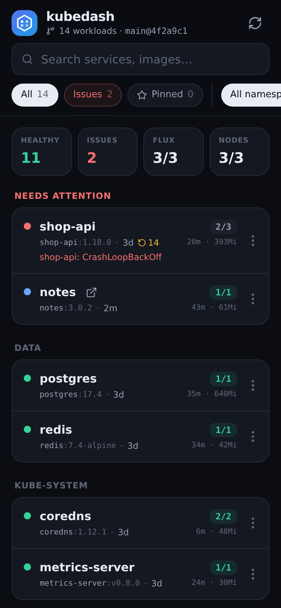
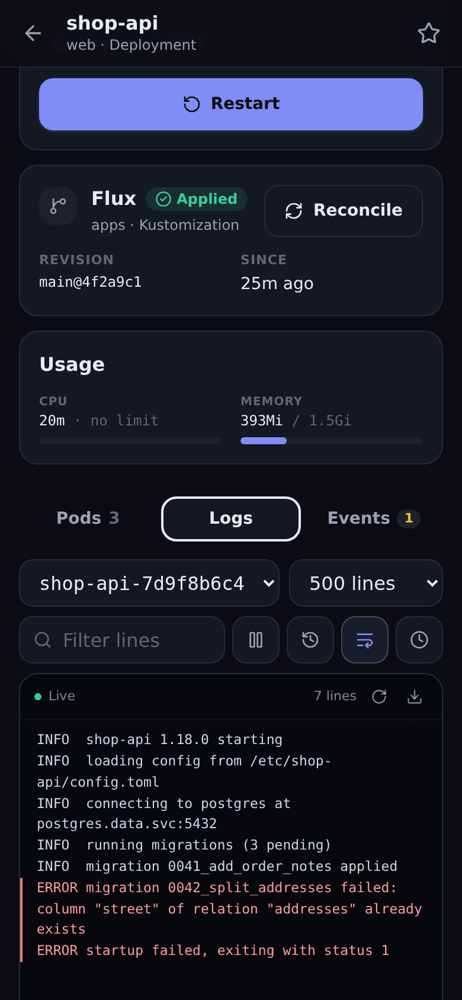

# kubedash

A small Kubernetes dashboard meant for checking on a homelab cluster from your
phone. It shows what's healthy and what isn't, lets you read logs, and can
restart a workload or delete a stuck pod. It isn't trying to replace `kubectl`
or a full admin UI.

<p>
  
  
</p>

## What it shows

The overview lists every Deployment, StatefulSet and DaemonSet with its ready
replicas, image tag, uptime, restart count and current CPU and memory use.
Anything in CrashLoopBackOff, failing to pull its image, unschedulable or stuck
in a rollout goes into a "Needs attention" section at the top. You can search,
filter by namespace and pin the workloads you care about (pins live in the
browser). If a workload is behind a Gateway API `HTTPRoute`, its hostname shows
up as a link.

A workload's page has its pods and containers, the last termination reasons,
recent events and live logs with a filter, previous-container logs and
download. With Prometheus configured it also draws usage history for the last
hour up to a week.

If the cluster runs Flux, each workload shows the Kustomization or HelmRelease
that applied it, with its revision and any errors, and **Reconcile** does the
same as `flux reconcile … --with-source`.

It installs as a PWA and has light and dark themes.

## Running it locally

```sh
nix develop
npm ci
cargo run --manifest-path backend/Cargo.toml   # API on :3001, uses your KUBECONFIG
npm run dev                                    # UI on :3100, proxies /api
```

The backend uses whatever cluster `KUBECONFIG` points at, so set
`KUBEDASH_READ_ONLY=true` if you only want to look. For the usage charts, port
forward Prometheus and pass its URL:

```sh
kubectl port-forward -n monitoring svc/prometheus 9090 &
KUBEDASH_PROMETHEUS_URL=http://127.0.0.1:9090 cargo run --manifest-path backend/Cargo.toml
```

## Configuration

| Variable                  | Default          | Purpose                                             |
| ------------------------- | ---------------- | --------------------------------------------------- |
| `KUBEDASH_BIND`           | `127.0.0.1:3001` | Listen address (`0.0.0.0:8080` in the image)        |
| `KUBEDASH_NAMESPACES`     | all              | Comma-separated allow-list of namespaces            |
| `KUBEDASH_READ_ONLY`      | `false`          | `true` disables restart, pod deletion and reconcile |
| `KUBEDASH_PROMETHEUS_URL` | unset            | Prometheus base URL for usage history charts        |
| `KUBEDASH_STATIC_DIR`     | unset            | Built UI to serve; already set in the image         |
| `RUST_LOG`                | `kubedash=info`  | Log filter                                          |

CPU and memory figures come from the Metrics API, so the cluster needs
metrics-server for those.

## Deploying

The image is `ghcr.io/fruitiex/kubedash`. In the cluster it uses its service
account, which needs read access to workloads, pods, pod logs, events,
services, nodes, HTTPRoutes, the Metrics API and Flux objects. The only write
permissions it uses are `patch` on Deployments, StatefulSets and DaemonSets
(restart), `delete` on pods, and `patch` on Flux Kustomizations, HelmReleases
and their sources (the reconcile annotation). Leave those out and set
`KUBEDASH_READ_ONLY=true` for a view-only install.

kubedash has no login of its own. Only expose it on a private network, or put
it behind a reverse proxy that handles sign-in (for example an OIDC proxy).
Mutating requests need an `x-kubedash` header, which browsers can't send
cross-origin without a CORS preflight that the server never approves, so other
sites can't trigger restarts.

## Development

The UI is React, TypeScript, Tailwind CSS and Radix UI, built with Vite. The
backend is Rust with axum and kube-rs.

```sh
nix develop
npm run typecheck && npm test && npm run format:check
(cd backend && cargo clippy --all-targets -- -D warnings && cargo test)
npm run build && cargo build --manifest-path backend/Cargo.toml
npm run smoke   # real backend against a fake Kubernetes API, UI loaded in Chromium
```

CI runs all of these on every pull request and publishes the image from `main`.
